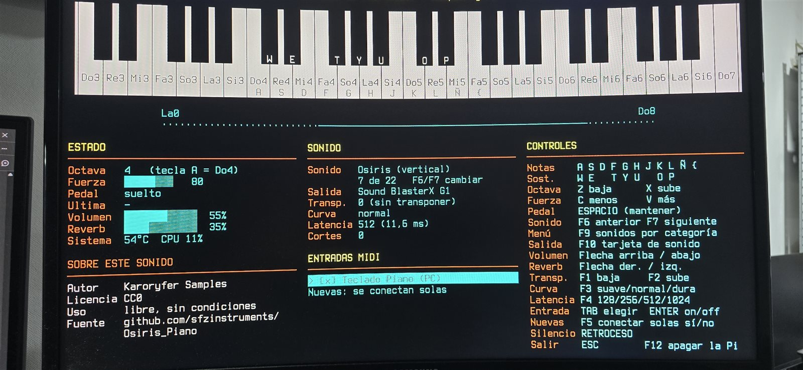
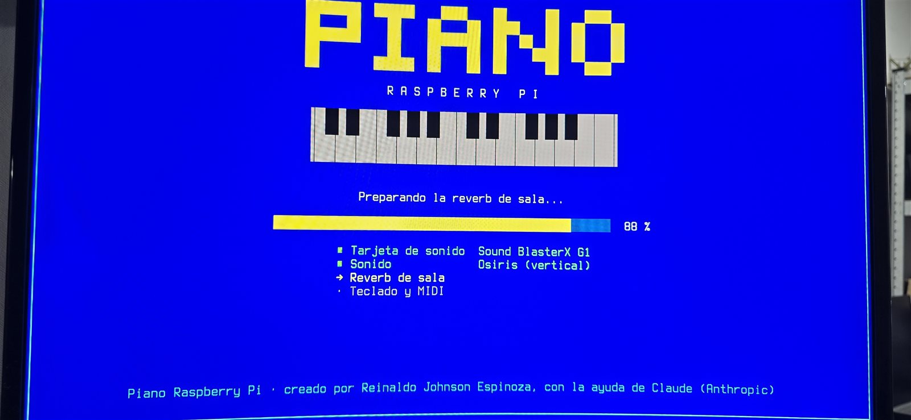

# Piano Raspberry Pi

> Español: [README.md](README.md)

Turns a **Raspberry Pi 3** into a **standalone digital piano**:
- **22 sounds**: grand, upright and electric pianos, organs, harpsichord, strings, harp, percussion and saxophone;
- **a menu by category** (F9) with search;
- **low latency**, room reverb and a full-screen console interface;
- **played with a computer keyboard** (up to 8 keys at once) **or a MIDI keyboard**.

Created by **Reinaldo Johnson Espinoza**, with the help of **Claude** (Anthropic). Full credits: [CREDITS.md](CREDITS.md).





## What it includes

- **Free sounds** from their original authors (Salamander, Splendid, Rhodes, Wurlitzer, Hammond, VCSL, VSCO 2 and others), with level, tuning and pedal **measured** so they all sound even.
- **Hot sound switching**:
  - F6/F7 steps through the sounds one by one, and F9 opens the menu by category;
  - while a sound loads, a window with a progress bar pauses the piano, so playing on cannot crash it.
- **Sound card of your choice (F10)**, switchable on the fly, with the volume remembered per card (the first time, at most 40 %, so a headset never surprises you). If it is unplugged while playing, nothing crashes: the piano warns you and reconnects by itself when you plug it back in.
- **Visible credits** for each sound (author, license and terms of use) on screen and in the menu.
- **On-screen controls**: volume, reverb, transposition, velocity curve, latency, MIDI inputs and an audio dropout counter.
- **More than 400 automated tests** (`ejecutar-pruebas.sh`), including real, silent audio tests.

## What you need

| | |
|---|---|
| Computer | **Raspberry Pi 3 Model B** (1 GB) with **64-bit Raspberry Pi OS (Bookworm)**, Lite (no desktop; recommended and tested from scratch) or with desktop |
| Power | The **official 5.1 V / 2.5 A supply**: weak supplies cause undervoltage and dropouts |
| Sound card | **Any USB sound card** (tested with the Sound BlasterX G1 and the Logitech G432 headset). The Pi's headphone output and HDMI also work, with lower quality. Chosen with **F10** |
| Keyboard | A USB computer keyboard; optionally a USB MIDI keyboard |
| Display | HDMI monitor (designed for 1080p) |
| Recommended | Ventilation: the Pi 3 gets hot under the piano's load |
| Storage | About **5 GB** free for the sounds (6 GB with Softify) |

## Installation

Everything is done **on the Raspberry Pi** (directly or over SSH).

1. **Required programs**. The Lite version does not include PipeWire or git; the desktop version already has some of them. The installer checks everything and tells you what is missing.
   ```bash
   sudo apt update
   sudo apt install git jalv mda-lv2 p7zip-full pipewire-bin pipewire-jack wireplumber
   ```
2. **Get the project**:
   ```bash
   cd ~
   git clone https://github.com/TestCeL/piano-raspberry-pi.git piano-raspberry-pi
   ```
3. **Download the prebuilt sfizz**: the file `piano-rpi-sfizz-1.2.3-arm64.tar.gz` from this repository's *Releases*. It is the synthesizer, with the project's patches and its licenses. On the Pi, without a browser:
   ```bash
   cd ~
   curl -LO https://github.com/TestCeL/piano-raspberry-pi/releases/download/v1.0/piano-rpi-sfizz-1.2.3-arm64.tar.gz
   ```
   To build it yourself, see [Building sfizz](#building-sfizz).
4. **Install**:
   ```bash
   cd ~/piano-raspberry-pi
   bash instalar.sh --sfizz ~/piano-rpi-sfizz-1.2.3-arm64.tar.gz
   ```
   - Copies the tools to `~/piano` and installs sfizz (checking its checksums) and the `piano` command.
   - Starts PipeWire if you just installed it, and shows the USB sound cards it can see.
   - Downloads and **verifies** the sounds (about 2.4 GB; it takes a while). If the connection drops (network or SSH session), run the same command again: **the downloads resume where they left off**.
   - With `--fuente-consola`, it also sets a large console font suited to 1080p (undo with `bash ~/piano/tools/fuente-consola.sh revertir`).
   - With `--arranque-automatico`, **the piano opens by itself when the Pi boots**, on screen and without typing anything (about 40 s on a Pi 3). The console logs in by itself, because sound runs inside a user's session. It never opens over SSH. After quitting with ESC you get the console: `piano` opens it again and `sudo poweroff` shuts down. Undo it with `bash ~/piano/tools/arranque-automatico.sh quitar`.
   - With `--comprobar`, it only checks the requirements.
5. **Softify (optional)**: its license does not allow redistribution, so it is downloaded by hand.
   - Create a free account on [Pianobook](https://www.pianobook.co.uk/packs/softify-piano-vol-1/) and download the zip.
   - Copy it to the Pi and run:
     ```bash
     python3 ~/piano/tools/instalar_softify.py "Softify Piano Vol 1 v1.1.zip"
     ```

To **update**, run `git pull` and then `bash instalar.sh` again. Without `--sfizz` the installed sfizz is kept, and your preferences are not touched.

## Usage

```bash
piano            # opens the piano with the last sound chosen; ESC to quit
piano -q 256     # with another latency (F4 also changes it)
```

| Key | Action |
|---|---|
| A S D F G H J K L Ñ { | Notes (white keys) |
| W E · T Y U · O P | Sharps (black keys) |
| Z / X | Octave down / up |
| C / V | Velocity down / up |
| SPACE | Sustain pedal (hold) |
| F6 / F7 | Previous / next sound |
| F9 | Sound menu by category (←/→ category, ↑/↓ choose, ENTER load, letters to search) |
| F10 | Sound card (↑/↓ choose, ENTER use) |
| ↑ / ↓ | Volume |
| → / ← | Reverb |
| F1 / F2 | Transposition |
| F3 | Velocity curve: soft / normal / hard |
| F4 | Latency: 128 / 256 / 512 / 1024 (256 or 512 recommended) |
| TAB / ENTER | Choose and enable MIDI inputs |
| F5 | Auto-connect new inputs: yes / no |
| BACKSPACE | Silence (stops all notes) |
| ESC | Quit |
| F12 | Shut down the Raspberry Pi (asks first: S yes, N no). Unplug it once the green light goes off |

While it loads you see a **start screen** in the style of old DOS games: the title in block letters, a drawn keyboard and a progress bar by stage (sound card, sound, reverb, keyboard). The bar estimates each sound from how long it took last time.

Keys work by **physical position**, so any keyboard layout works (the table shows a Spanish layout). The piano saves your preferences (sound, latency, reverb…) in `~/.config/piano/preferencias.json`. The interface is in Spanish.

## Tests

```bash
bash ~/piano/tools/ejecutar-pruebas.sh
```

Everything is tested **silently**: nothing ever plays through the sound card. If the piano is open, the tests do not run, because they would stop it.

## Building sfizz

On a PC with Docker and arm64 emulation (QEMU/binfmt; Docker Desktop includes it). From the repository folder:

```bash
docker build --platform linux/arm64 --build-arg PLATAFORMA=linux/arm64 -t sfizz-builder:bookworm-arm64 tools/build-sfizz
docker volume create sfizz-work-arm64
docker run --rm --platform linux/arm64 -v sfizz-work-arm64:/work -v "$PWD/dist/sfizz-1.2.3-arm64:/out" sfizz-builder:bookworm-arm64
```

- It downloads the official sfizz 1.2.3 source (verifying its SHA-256), applies the patches in [`tools/build-sfizz/patches/`](tools/build-sfizz/patches/README.md) and leaves `sfizz_jack`, `sfizz_render`, `BUILDINFO` and `SHA256SUMS` in `dist/sfizz-1.2.3-arm64/`.
- The first time takes quite a while, because it compiles under arm64 emulation.
- The result is **reproducible**: it gives exactly the same programs as the published package.
- In Git Bash on Windows, prefix the command with `MSYS_NO_PATHCONV=1` and use a Windows path in `-v`.
- The release package is made with `bash tools/build-sfizz/empaquetar-publicacion.sh`.

## Known limitations

- **Sound card**: the piano runs at 44.1 kHz; with a card that does not support it, it uses 48 kHz, but switching to it on the fly is not possible: it is used the next time the piano opens.
- **MIDI keyboard**: supported, but not yet tested with a real MIDI keyboard.
- **PipeWire 1.2.7** has a bug that can crash an audio client when an output loses its last link. The project avoids it: it connects before disconnecting, and the reverb always has an "anchor" linked. It is fixed in PipeWire 1.6.
- **WirePlumber 0.4.13** (Debian 12's) crashes if a sound card is unplugged during the 5 s it waits before suspending it. The piano suspends the card as soon as it stops using it (when switching with F10 and when it closes). If WirePlumber restarts anyway, the piano relinks everything by itself within a few seconds. Version 0.4.17 already fixes it.
- **Raspberry Pi 3**: up to 32 voices per sound; dropouts may occur at latency 128.
- **Autostart**: when enabled, anyone with the Pi's keyboard gets an open session (with `sudo`). At home this rarely matters; if it matters to you, do not enable it.

## Documentation

The development is documented by phase, in Spanish, in [`docs/`](docs/): goals, decisions, measurements, tests and solved problems.

## License

The project's code and documentation are licensed under **MIT** ([LICENSE](LICENSE)). The **sounds are not included**: each one is downloaded from its source and has its own license. The licenses of the sounds and of the third-party programs are in [CREDITS.md](CREDITS.md).
